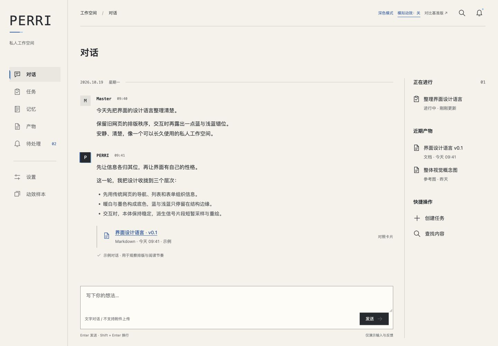

# Secretary Phase UI Design

PERRI / Secretary 的独立 UI 样式探索稿。当前版本 **v0.5**，以已确认的 **v0.3 布局**为基准，修正静态层级与信号采样。

这是可点击的设计稿，不是生产前端：没有后端连接、框架、构建过程、外部字体或运行时依赖。所有任务、消息、通知和授权均为明确的示例。界面动作不会执行真实业务。

## 复现

```sh
git clone https://github.com/ExplodeCode6324/secretary-phase-ui-design.git
cd secretary-phase-ui-design
python3 -m http.server 4318 --bind 127.0.0.1
```

浏览器打开 <http://127.0.0.1:4318>。Windows 可将 `python3` 换成 `py -3`。也可直接打开 `index.html`；使用本地服务器能获得更一致的主题存储行为。端口被占用时替换为任意空闲端口。

建议使用近期版本的 Chrome、Edge、Firefox 或 Safari。页面使用 SVG、CSS Grid、原生 dialog 和 inert。无需 Node.js；Node 仅用于可选语法检查。

## 当前复核入口

- **顶部深色/浅色切换**：只改变颜色，布局不变。主题保存在当前浏览器 origin 的 localStorage；不可用时仍能在当前页切换。
- **顶部模拟动效开关**：观察静态界面与模拟层的差别。
- **任务 → 展开 / 收起**：列表在原行下方展开详情；支持键盘触发和连续反向切换。
- **对话输入框**：聚焦时只扫描边界，正文和输入法不重绘。
- **按钮**：本体稳定，悬停采样、按下清理信号、有效激活立即响应；拖离释放不提交。
- **页面切换**：分段重绘与边缘定位；同页筛选或发送不会重新播放整页进场。
- **动效样本**：静态本体与信号采样对照，自动或固定四种方案；含铃铛、搜索、发送及 16 px 样本。
- **设置**：线稿/完整样式、动效强度、示例指令复核。

系统“减少动态效果”优先；减弱、关闭或顶部关闭模拟动效后，状态和列表展开仍可使用。主题选择之外的业务示例只存在内存中，刷新还原。

## 文件结构

| 文件 | 用途 |
| --- | --- |
| `index.html` | 当前入口与页面外壳 |
| `style.css` | v0.3 布局、静态层级、信号片段及界面动效、深浅色变量 |
| `prototype.js` | 本体路径与采样区域、静态页面与业务示例，无网络请求 |
| `signal-motion.js` | 单控件单效果、有限采样参数和取消生命周期 |
| `tests/signal-motion.test.cjs` | 参数边界、重复接触合并及清理竞态检查 |
| `Simulated_Old_Web_Design_Language_v0.1.md` | 当前设计约定；文件名沿用以兼容链接 |
| `API-UI-Mapping.md` | 页面对象与 Core 接口的设计对应，不是接口实现 |
| `AGENTS.md` | 后续 agent 的工作边界和复核要求 |
| `versions/v0.3/` | Master 确认的布局基准，保持历史状态 |
| `versions/v0.1/`、`versions/v0.2/` | 前两轮对比样式 |
| `概念图/` | 原始视觉参考；其中红蓝配色不是现行规范 |
| `preview/` | 历次实际浏览器截图 |

## 当前静态调整

右栏小节和说明区域取消重复边线，删除重复英文眉题与标签；有效数量、状态、时间保留。快捷操作改为横向图标＋文字。对话产物默认文件条目，点击“对照卡片”观察局部包装差异。三栏比例、外边距与主要流程保持。

## 设计约束

- 当前基准为第一版布局与第二版动效的整合版。未获新要求前，不调整布局。
- “被模拟的旧互联网”：平直、文档式的界面；互动时只从本体真实路径派生少量信号片段；本体轮廓、锚点、比例和 1.5 基准笔画固定。
- 常规颜色为蓝色＋浅蓝。红色只用于失败、重大设置变更与重点标记。
- 不恢复装饰标语。动效不能移动点击范围、复制正文或延迟业务动作。
- 图标本体不拉伸、缩放、回弹或拆分；辅助射线、十字与拖尾不混入本体。信号层最多两段，小图标一段，少数线宽档位直接作用于片段。
- 悬停与聚焦合并；激活替换；移出、失焦、禁用、关闭动效时清理。不逐帧随机、不排队、不重复提交。
- 保持独立静态样式稿。正式技术选型与后端接入另行确定。

## 本地检查

```sh
node --check prototype.js
node --check signal-motion.js
node --test tests/signal-motion.test.cjs
python3 scripts/check-preview.py
```

人工复核：深浅色页面、刷新保留主题、任务反复展开/收起、消息输入、按钮按住与拖离、键盘焦点、弹窗 Esc、窄窗口、减少动态效果。检查结果只代表设计预览，不代表后端验收。

## 当前视觉

同一 1440×1000 视口的 [修改前浅色](preview/v05/before-light.png)、[修改后浅色](preview/v05/after-light.png)、[修改前深色](preview/v05/before-dark.png)、[修改后深色](preview/v05/after-dark.png)。


