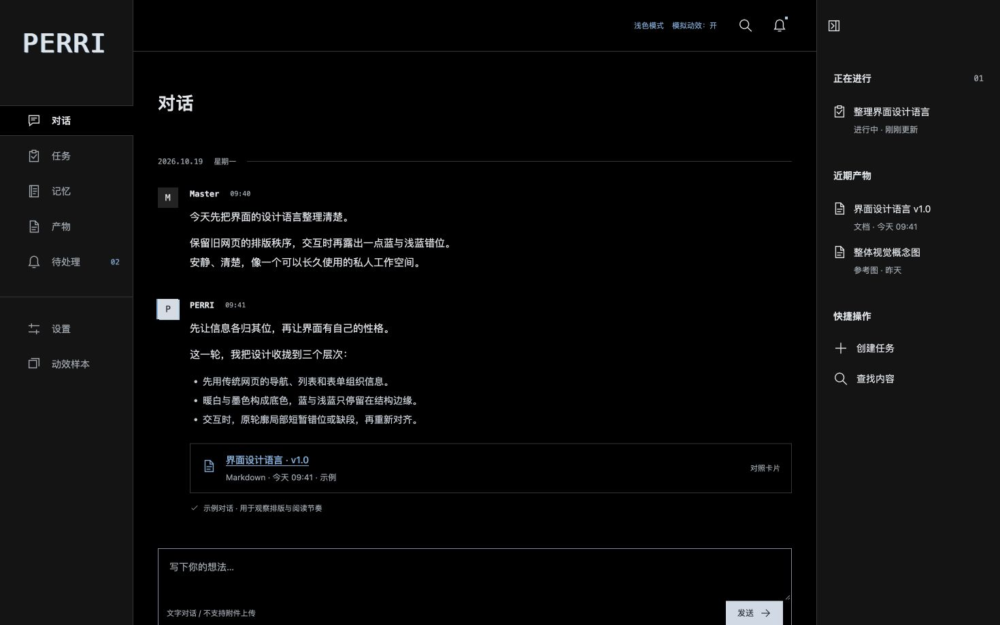

# PERRI Phase UI Design

**第一版正式设计 v1.0 · 已冻结 · 2026-10-19**。固定发布标签：`v1.0.0`。

传统网页的清楚秩序，交互时通过三层、三帧显示故障表现“被模拟的旧互联网”。这是可点击的静态设计参考，所有数据为人工示例，没有真实后端或运行时依赖。

## 复现冻结版本

```sh
git clone https://github.com/ExplodeCode6324/secretary-phase-ui-design.git
cd secretary-phase-ui-design
git checkout v1.0.0
python3 -m http.server 4320 --bind 127.0.0.1
```

打开 <http://127.0.0.1:4320/#conversation>。Windows可用 `py -3`。端口占用时换空闲端口。Node仅用于开发检查，不是预览依赖。

## 设计与代码

- [完整UI设计规范](UI-DESIGN.md)：总体布局、颜色、品牌、左右栏、输入、头像、三层三帧、取消与无障碍；每部分链接参考代码。
- [接口信息结构映射](API-UI-Mapping.md)：设计依据，接入前重新核对。
- [Tauri两帧/三帧开销](TAURI-MOTION-COST.md)：实现成本与未实测边界。
- [发布检查与截图](preview/v1.0/VALIDATION.md)。
- [index.html](index.html) 页面外壳；[prototype.js](prototype.js) 示例页面和操作；[style.css](style.css) 样式；[signal-motion.js](signal-motion.js) 故障渲染与生命周期。

`/#motion` 可重复检查A/B/C、三帧冻结、品牌/头像及发送按钮。两帧为诊断开关，不是历史版本。源概念图继续作为参考素材保留；旧设计入口、规范与截图已从当前树清理，历史可通过Git恢复。

## 检查

```sh
node --check prototype.js
node --check signal-motion.js
node --test tests/signal-motion.test.cjs
python3 scripts/check-preview.py
```


