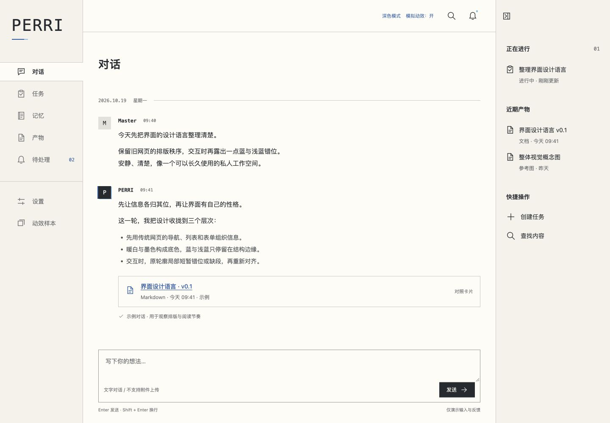

# Secretary Phase UI Design

PERRI / Secretary 的独立 UI 样式探索稿，当前 **v0.9**，三帧效果已确认为基线。保留三栏空间、页面与示例流程，调整显示故障、目录接边和提交边界反馈。

这是可点击的静态设计稿，没有后端、框架、构建过程、外部字体或运行时依赖。所有内容为人工示例，界面不会执行真实业务。

## 复现

```sh
git clone https://github.com/ExplodeCode6324/secretary-phase-ui-design.git
cd secretary-phase-ui-design
python3 -m http.server 4318 --bind 127.0.0.1
```

打开 <http://127.0.0.1:4318>。Windows 可用 `py -3`。端口占用时换空闲端口。也可直接打开 index.html；本地服务器便于主题存储。无需 Node；Node 仅供可选检查。

## 本轮复核

- `/#motion`：A 同色分带、B 实际笔画缺采样、C 组合与双色、静态完整、自动变化。先看铃铛、搜索、任务。
- “仅同色”关闭辅助彩色残像，仍能看见真实断裂。“冻结故障帧”与“冻结帧：第一/第二/第三帧”用于对比三帧；“逻辑帧数”可切换2/3，时长一致；冻结只用于样本检视，移出/失焦即可恢复；关掉后重播验证140–200ms时序。
- 左侧菜单为整行目录，选中行与正文同色，并在该行真正中断右侧竖线；边界故障结束后选中态保留。
- 对话发送只追加本地示例消息，不重建输入DOM。鼠标与Enter统一触发一次140ms右边线局部错位，不移动文字/按钮。Shift+Enter换行，组合输入不提交。
- 实际发送键恢复 v0.3 的箭身收放、箭头投射与拖尾（420ms），按钮方块播放160ms三帧故障。动效样本页有独立“发送按钮”入口。
- 保留深浅色、任务展开、文件查看与卡片对照。系统减少动态效果、减弱、关闭模式不播放故障，状态与操作仍可用。

历史版本目录与旧截图已删除，Git历史仍可恢复旧文件。

## 实现与边界

源几何固定，显示图像可缺失或错位。播放时隐藏完整静态图，替换为带蒙版缺口的真实源笔画及裁片；结束或取消后恢复原图。双色残像只是辅助，不承担核心机制。

不使用弹簧、缩放挤压或旋转；不移动点击区域，不延迟操作。固定A/B/C可重复，自动参数在开始时一次选定。每帧一条横带和至多一个缺段区域，小图标减量。默认三个不同逻辑帧按0%、26.67%、53.33%切换，80%恢复完整。第二帧反向并换区，第三帧使用更窄的上方裁片、半幅位移和另一缺段；总时长不变。两帧对照保留0%/40%时序。

浅色侧栏米色、正文暖白；深色使用纯黑主体（#000000）与极深灰侧栏（#141414）。常规颜色蓝与浅蓝，红色限于失败、重大设置变更与重点标记。已确认的右栏信息层级、文件条目与横向快捷操作保留。

## 文件

| 文件 | 用途 |
| --- | --- |
| `index.html` | 当前页面外壳 |
| `prototype.js` | 源图标、页面、原生交互与示例状态 |
| `signal-motion.js` | 分带/缺采样渲染及单控件取消生命周期 |
| `style.css` | 三栏、目录接边、深浅色和显示层 |
| `Simulated_Old_Web_Design_Language_v0.1.md` | 当前完整设计规范，沿用文件名 |
| `AGENTS.md` | 后续工作规则 |
| `API-UI-Mapping.md` | 设计对象与Core接口映射，不是接口实现 |
| `tests/signal-motion.test.cjs` | 遮罩机制、参数、取消和提交边界测试 |
| `scripts/check-preview.py` | 静态资源及无后端请求检查 |
| `preview/v09/` | 本轮截图与验证记录 |

## 检查

```sh
node --check prototype.js
node --check signal-motion.js
node --test tests/signal-motion.test.cjs
python3 scripts/check-preview.py
```

人工复核包括深浅色、窄屏、A/B/C实际播放和恢复、键盘、快速重复、按下拖离、动画中关闭、列表与文件。检查不代表真实后端验收。

## 当前视觉



性能分析见 [Tauri 动效开销](TAURI-MOTION-COST.md)。

## v0.9 模块边界

右侧“正在进行”“近期产物”“快捷操作”合为一个独立活动侧栏，与左侧同用 `--sidebar-paper` 背景。活动栏位于工作区第三列，通顶通底，不再给三个分组分别画框。其他页面说明栏同样成框。原有文件条目孤立左线与动效网格悬空竖线改为接通模块上下边界；不移动文字或全局压缩间距。活动栏可收起为48px窄轨。窄屏默认收起，展开覆盖右侧区域，正文不因展开而重排。切换只修改布局状态和hidden/aria-expanded，不重建输入或消息；图标悬停/聚焦使用同一三帧phase，文字与模块无装饰位移。

当前深色基线：主体与输入区域纯黑 #000000，左右侧栏极深灰 #141414。移除品牌区“私人工作空间”和顶部工作空间面包屑。顶部、底部与导航结构分割线接到区域边界，内容用内边距对齐，不以外边距缩短分割线。
